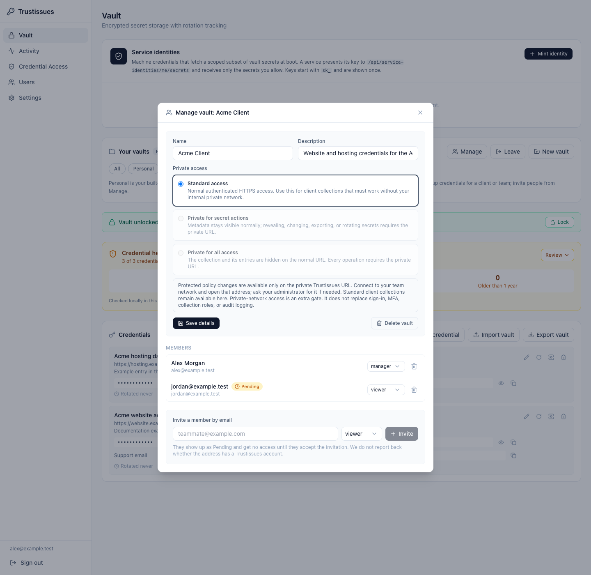
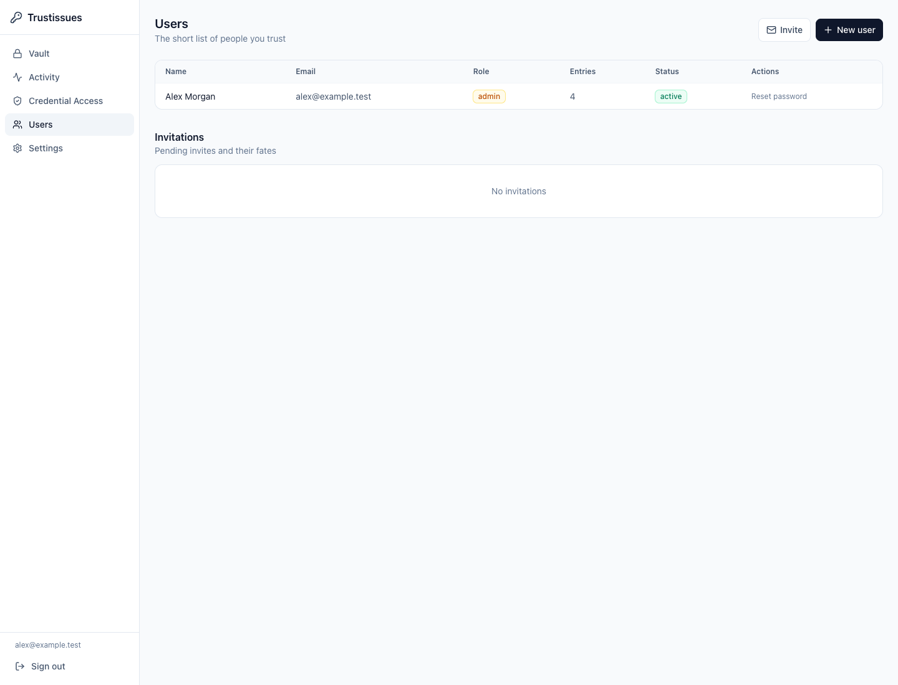
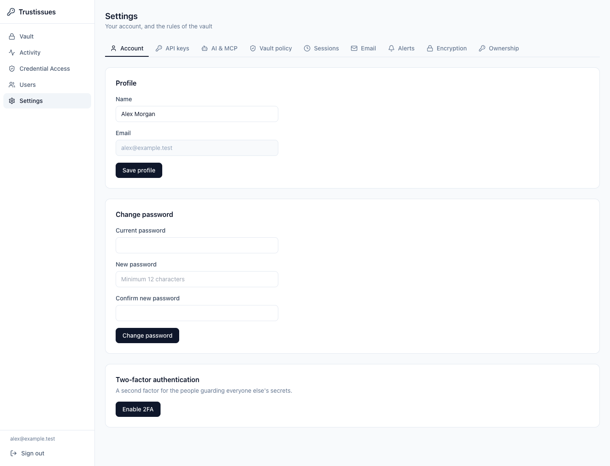
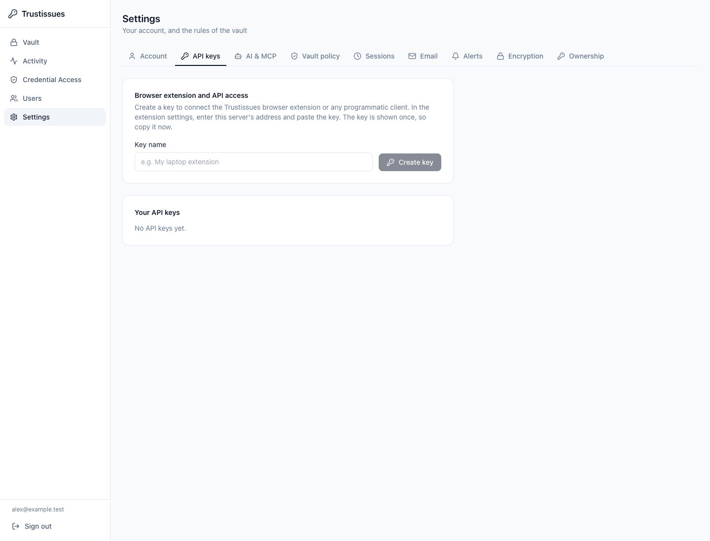
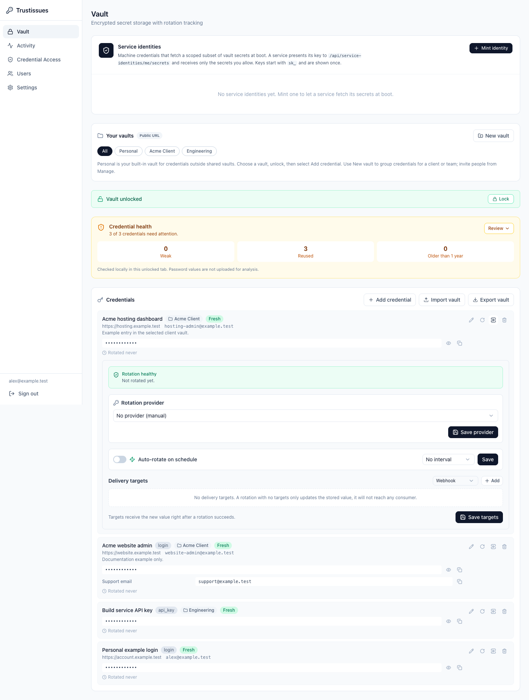
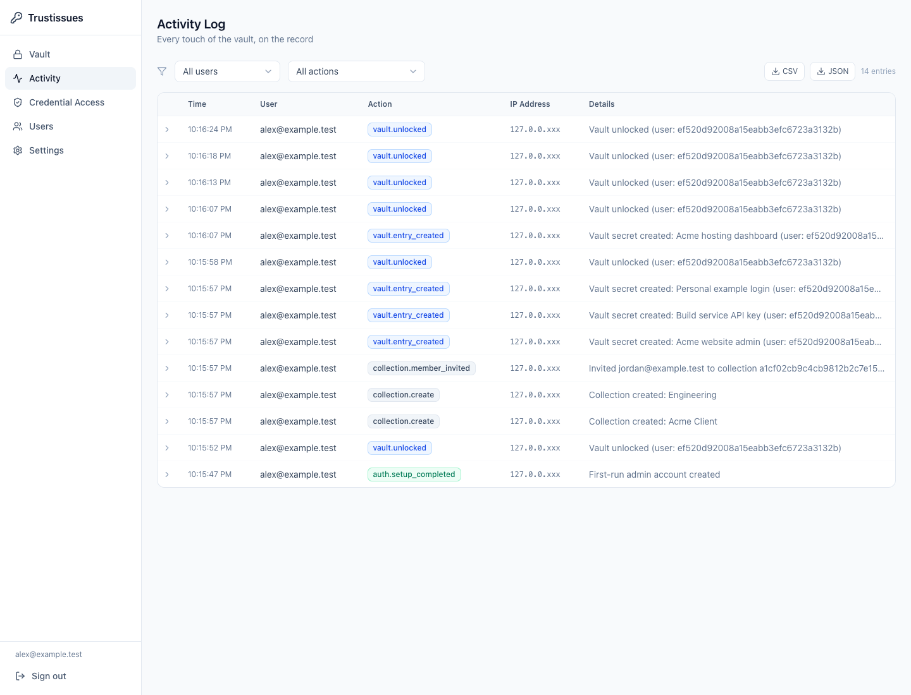
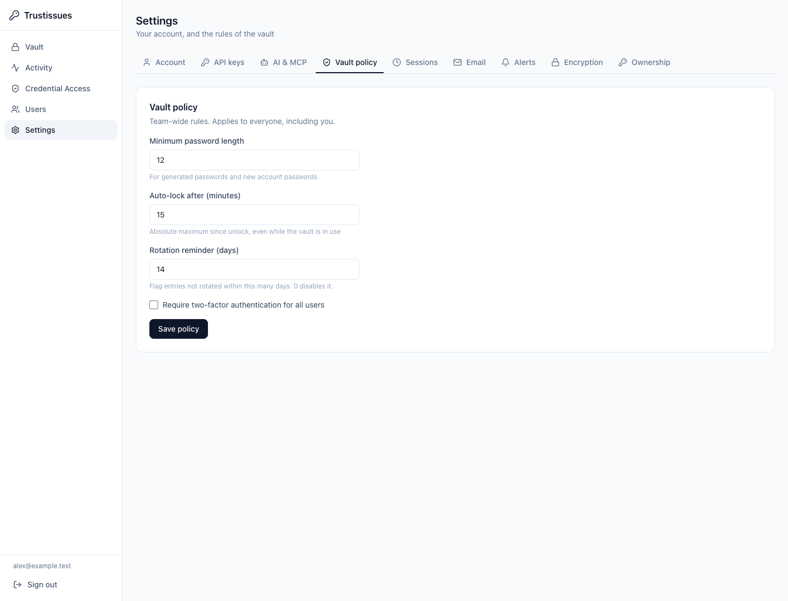

# TrustIssues administration and team guide

This guide explains accounts, shared vaults, client access, rotation, and instance settings. It describes source release **`823c618`**, checked on **18 October 2026**. The screenshots show an isolated demonstration instance with invented accounts and credentials. Names, dates, counts, and available settings on your instance may differ.

Start with the [User guide](USER-GUIDE.md) for creating vaults, adding credentials, unlocking, searching, and importing or exporting. This guide is for account administrators, shared-vault managers, and teammates connecting a browser extension.

## Find the right instructions

- [Understand account and vault roles](#account-roles-and-vault-roles).
- [Share a vault with a teammate](#share-a-vault-with-a-teammate).
- [Set up access for an external client](#set-up-an-external-client).
- [Protect your account with MFA](#account-settings-and-two-factor-authentication).
- [Connect an extension or API client](#api-keys-and-browser-extension-connection).
- [Configure rotation and delivery](#credential-rotation-and-delivery).
- [Review activity and credential use](#activity-and-credential-access).
- [Configure instance settings](#instance-settings).
- [Recover safely and offboard access](#recovery-and-offboarding).

## Account roles and vault roles

An **account role** controls instance-wide access. A **vault role** controls membership in one shared vault. The interface sometimes uses **collection** for a shared vault; these mean the same shared container.

### Account roles

| Account role | Vault access | Navigation and settings |
|---|---|---|
| **Admin** | Can read, use, and manage every entry, including entries in other accounts' Personal vaults; has manager authority over every shared vault. | Vault, Activity, Credential Access, Users, and all Settings tabs. |
| **User** | Own Personal entries and shared vaults where membership has been accepted, subject to the assigned vault role. | Vault; Account, API keys, and AI & MCP settings. |
| **Vault only** | Own Personal entries and accepted shared-vault membership, subject to the assigned vault role. | Vault; Account and API keys settings. AI and MCP access is blocked. |

**Personal does not mean hidden from administrators.** TrustIssues uses a trusted server model: the running server can decrypt stored values, and instance administrators have broad vault access. Give Admin only to people trusted with the whole instance. See the [threat model](../THREAT-MODEL.md).

Those account permissions are broader than the current bulk-unlock/export selection. The web export selects the caller's Personal entries and accepted shared-vault memberships available on the current route; being Admin does not turn it into an all-instance export. Use the [database backup procedure](BACKUP.md) for instance recovery.

User and Vault only do not automatically see every shared vault. Conversely, granting a shared-vault manager role does not make someone an instance administrator.

### Shared-vault roles

| Permission in that vault | Viewer | Editor | Manager |
|---|---|---|---|
| See entries and their metadata | Yes | Yes | Yes |
| Reveal and use credentials, subject to normal unlock and policy checks | Yes | Yes | Yes |
| Add and change entries | No | Yes | Yes |
| Manage the vault's name, description, and membership | No | No | Yes |
| Delete the shared vault and its contents | No | No | Yes |

A Viewer can obtain credential values through permitted reveal/use operations. Choose Viewer when someone may use the credentials but should not edit them; it is not a metadata-only role.

Choosing where a secret may be delivered has an additional authority check. Adding or widening delivery destinations requires the recorded secret owner with current management access, or an instance Admin. Being a collection Editor or Manager alone does not grant this authority. Narrowing or clearing destinations remains available to authorized managers of the entry.

Membership removal ends the removed person's collection-based use and management rights. The original entry creator can retain a recovery-read right to their own entry; this does not grant delegated credential use or management. Do not treat removal as a promise that all historical recovery access is erased. Removing someone also cannot erase values already copied to another device. Rotate shared credentials when those existing copies should stop working.

## Share a vault with a teammate

Any signed-in account can create a shared vault and becomes its first Manager. Use a descriptive name, such as **Website operations**, rather than putting unrelated client credentials into one large vault. Follow the [User guide](USER-GUIDE.md) for creation and entry placement.

1. Open **Vault**, select the shared vault, and choose **Manage**. The dialog heading is **Manage vault: …**.
2. In **Invite a member by email**, enter the teammate's account email address.
3. Choose **viewer**, **editor**, or **manager** according to the permission table above.
4. Select **Invite**. The member appears as **Pending**.
5. Ask the teammate to sign in and review the pending collection invitation in Vault.
6. The teammate selects **Accept** to activate membership, or **Decline** to reject it.

Pending membership grants no credential access. The invitee must accept before entries appear in their vault or become available to extension matching. An invitation can be recorded before the email address has an account; the manager's response deliberately does not reveal whether that account exists.

To change a member's role, select the new role in the member list. To remove an accepted member, use that member's remove control. A pending row has **Withdraw invitation**, which cancels the unaccepted invitation.

The last accepted Manager cannot be removed, demoted, or leave the vault. Promote another accepted member to Manager first so the vault retains someone who can administer it.

Deleting a vault deletes its credentials and membership. The confirmation checks the actual entry count and names the number of credentials that will be destroyed. If checking fails, use **Retry**; if contents changed, review the refreshed count and confirm again. There is no in-product undo. See [Backups](BACKUP.md) for operator recovery rather than assuming a deleted vault can be restored from this dialog.

### Public and private access policies

| Manage-vault option | How users reach it |
|---|---|
| **Standard access** | Normal authenticated HTTPS. Appropriate for client vaults that must work without the internal private network. |
| **Private for secret actions** | Metadata remains visible normally; secret actions such as revealing, changing, exporting, or rotating require the private URL. |
| **Private for all access** | The vault and entries are hidden on the public route; all operations require the private URL. |

The protected choices depend on the operator configuring a separate private ingress. Changes to protected policies require the private TrustIssues URL. A disabled choice is not a missing role invitation and is not repaired by repeatedly signing in.

Private access adds a network admission check. It does not replace account authentication, MFA, vault roles, or logging, and does not automatically route outbound provider calls or webhooks through the private network. See [Private ingress](PRIVATE-INGRESS.md) for operator setup and recovery.

## Invite or create an account

**Admin only:** open **Users**. This page lists each account's name, email, account role, entry count, and active/disabled status.

### Invitation method

1. Select **Invite**.
2. Enter the person's name and email.
3. Choose the account role. Use **User** for an ordinary teammate, **Vault only** for a restricted client/extension account, and **Admin** for a trusted instance operator.
4. Keep **Send the invitation by email** selected only when the instance has working SMTP settings.
5. Select **Create invitation**. The pending invitation appears in the Invitations list.
6. Deliver the copied invitation link securely if email is not being used. The invitation includes an account-creation code; handle the link as sensitive.
7. The invitee opens the link, chooses their own password, and selects **Create account**.

An invitation can be resent, copied again while pending, or deleted. Account creation does not accept a separate vault membership invitation automatically: the invitee still reviews it in Vault.

### Direct account creation and changes

**New user** lets an administrator create an account with a name, email, starting password, and role. Prefer an invitation when the person can choose their own password. If using a starting password, deliver it securely and have the person change it.

For other accounts, the role selector changes the account role and **Disable/Enable** changes whether they can sign in and operate. The current administrator's row does not offer self-disable or self-delete controls. **Reset password** is for resetting another user's password; it also revokes that user's API keys, so their extension and programmatic clients need new keys.

User deletion is more destructive than disablement: Personal credentials are permanently deleted; credentials the user created inside shared vaults stay with the team and transfer custody to the acting administrator. Service keys issued by that user are revoked and services using them need provisioning again. Read the confirmation before proceeding.

## Set up an external client

Client access uses two separate invitations: one creates the account, and the other offers membership in the chosen vault. The extension does not redeem either invitation.

1. Create a dedicated **Standard access** vault for the client.
2. Invite the client's email to that vault, usually as **Viewer** unless editing is needed.
3. In **Users**, create a **Vault only** account invitation for the same address.
4. The client follows the account invitation in the web app and chooses a password.
5. The client completes any required two-factor enrollment in **Settings → Account**.
6. In **Vault**, the client explicitly accepts the pending vault invitation.
7. If using the browser extension, the client creates a named API key in **Settings → API keys**, copies it once, and configures the extension manually.

Vault-only onboarding displays a checklist with links to these tasks. It keeps each task in a separate tab so the remaining steps are still visible. A standard client vault uses the public URL; leave the extension's private URL empty unless the operator separately supplies one.

## Account settings and two-factor authentication

Every role can open **Settings → Account**. **Profile** changes the display name; email is read-only here.

### Change your password

Enter your current password, new password, and matching confirmation, then select **Change password**. The form requires at least 12 characters and the server also applies the account-password policy. A successful change revokes sessions and signs you out. Sign in again using the new password.

### Enable MFA

1. Select **Enable 2FA** in **Two-factor authentication**.
2. Scan the QR code with your authenticator, or enter the displayed setup seed manually.
3. Enter your TrustIssues account password and the current authenticator code.
4. Select **Verify** to finish enabling the second factor.
5. Save the recovery codes when shown. They are displayed once; select **I saved them** after storing them safely.

Keep recovery codes outside this vault so they remain accessible if you cannot sign in. Treat the setup seed and recovery codes as account credentials; do not include your real setup screen in tickets or shared screenshots.

On later sign-ins, submit email and password, then enter the current authenticator code or a recovery code and select **Verify**. A recovery code provides a way back in when the authenticator is unavailable.

If the administrator requires MFA and you have not enrolled, you can still sign in to finish setup, but vault operations and API-key creation remain blocked. Follow the enrollment banner to Account settings. Disabling MFA requires your password and a TOTP or recovery code; a mandatory-MFA policy prevents disabling it until an administrator changes that policy.

## API keys and browser-extension connection

Every role can create its own named API keys from an interactive web session. An API key authenticates a client as its account; it does not grant a new account role or bypass current vault membership and policy checks.

1. Complete required MFA and accepted vault membership first.
2. Open **Settings → API keys**.
3. Enter a name identifying the browser/device or application, such as **Work laptop extension**.
4. Select **Create key** and copy the full key immediately. It is shown once.
5. In the extension settings, enter the public TrustIssues server URL and paste the key.
6. Add the operator-supplied private URL only if you use protected internal vaults. It must be the exact HTTPS origin with a different hostname from the public URL.
7. Save and test the extension connection.

The public server URL is the address of your TrustIssues instance, not an invitation link or `/api` endpoint. Invitation codes cannot reconnect an extension. Obtain an approved extension package or installation method from the instance operator; this guide does not establish browser-store availability.

**Your API keys** shows each key's name, masked prefix, Live/Revoked/Expired state, expiry, and last-use information. The full key cannot be recovered because the server stores a hash. Revoke a lost/exposed key and create a replacement with a new name. An existing API key cannot mint its own successor; key creation requires the interactive account session.

Changing an extension URL or its API key locks that connection and clears its decrypted session. Keep each browser's key separate so one lost device can be revoked without changing every connection. Revoking a key ends future authenticated requests with it; rotate any credentials that may already have been revealed.

## Credential rotation and delivery

Rotation changes a credential's value. Delivery distributes the replacement to configured consumers. Provider validation, old-key revocation, persistence, and consumer delivery are distinct outcomes; review the result rather than assuming one success message proves every part.

Open the entry's **Manage rotation delivery** panel after unlocking the vault. The provider, schedule, and targets have separate save controls. Saving one section does not save edits in the others.

### Configure a provider and schedule

1. Select the **Rotation provider** that matches the credential.
2. Fill in the required provider fields shown below the selector, then select **Save provider**.
3. Read the predecessor warning explaining what happens to the previous key.
4. Choose a rotation interval: 30, 45, 60, 90, 180, or 365 days.
5. Turn on **Auto-rotate on schedule** and select its **Save** control.
6. Configure delivery below if another application must receive the replacement.

**No interval** does not schedule a rotation, even if the switch is on. Providers marked **reminder only, no auto-rotate** do not gain automatic rotation by enabling the schedule. A rotation reminder is a prompt for a human to act; it is not proof that the vendor key changed.

| Catalog group | Providers and important limits |
|---|---|
| Automatic rotation adapters | Vercel, Resend, SendGrid, Twilio, Linode/Akamai, Neon, Datadog, Grafana, Fastly, Auth0, Zitadel, Backblaze B2, and Forgejo/Gitea. Each needs the correct vendor permissions and configuration; catalog presence does not prove it is configured or tested on your instance. |
| Local generation | Shared Secret and Generated AES-256 Key produce local replacement values. They do not automatically update consumers without delivery targets. |
| Validation/reminder-only catalog | GitHub, AWS IAM, OpenAI, Anthropic, Stripe, Groq, Mistral AI, Together AI, Replicate, DigitalOcean, Hetzner, Sentry, Postmark, Mollie, Supabase, Railway, Render, and Manual. Validation capability and required metadata depend on the adapter. |
| Cloudflare | Appears in the catalog, but rotation is intentionally refused in this release because the vendor roll invalidates the old value in place before safe replacement persistence can be guaranteed. Do not rely on its automatic schedule. |

Required fields appear from the provider catalog. Examples include Twilio Account SID, Backblaze account/key IDs, Auth0 tenant/client ID, Grafana instance/service-account ID, and Datadog Application Key. These fields identify the correct vendor account or supply additional authority; use the specific values for that credential and protect them accordingly.

### Understand the previous-key warning

- **Rotating destroys the key it replaces:** the adapter records revocation as part of the rotation flow. Check the actual result and any outstanding-revocation warning.
- **Not verified whether rotating destroys the key it replaces:** do not assume the old key is dead. Verify/revoke it at the provider when retiring it matters.
- **No vendor key to revoke:** a locally generated secret has no corresponding vendor key; consumers still need the replacement value.
- A reminder-only provider does not automatically replace a key here.

Revocation behavior is deliberately provider-specific. Rotating a compromised key is complete only when the replacement works, intended consumers have it, and the previous credential no longer grants unwanted access.

### Configure delivery targets

| Target | Required configuration | What it does |
|---|---|---|
| **Webhook** | URL and optional HMAC signing secret; optional label. | Posts the replacement value to an authorized HTTPS receiver. The receiver must apply it to its consumer. |
| **Forgejo secret** | Instance URL, repository `owner/name`, Actions secret name, and auth-token vault entry name. | Updates the named repository Actions secret using the referenced credential. |
| **Notify only** | Optional label plus enabled notification channels configured by an Admin. | Sends a notification. It does not deliver the replacement credential to an application. |

Choose a target type, select **Add**, fill the fields, then **Save targets**. The save replaces the edited target list. Removing all rows and saving deliberately clears delivery. If targets fail to load, saving stays disabled: use **Retry** rather than treating the list as empty.

With no targets, a rotation only updates the stored value. With no enabled notification channel, Notify only delivers no external notification. The entry's management rights and the separate secret-destination authority check still apply to saving and later delivery.

### Handle partial failure and outstanding old keys

Read **Last rotation did not fully verify**, any delivery error, and any **An older key at this provider is still live** banner. A replacement can be stored while revocation or delivery fails. Do not keep rotating blindly while consumers may still have the previous value.

**Retry the revoke** opens a password prompt; enter your account password and select **Retry**. If you delete the old key manually at the provider, choose **I deleted it myself**, type the displayed predecessor ID, and select **Confirm, clear the record**. This acknowledgment updates TrustIssues' record; it does not delete a key at the provider. Another outstanding predecessor can appear afterward.

If the banner cannot identify the predecessor, it cannot be acknowledged by typing a blank ID. Retry revocation or ask an administrator to investigate the provider-side record. **Rotation healthy / Not rotated yet** means no recorded latest error; it does not prove a provider or consumer has already been tested.

## Activity and Credential Access

Both pages are **Admin only** because the records identify vault entries, people, and credential destinations. Treat exported logs as sensitive account/inventory data even when they do not contain credential values.

### Activity Log

Use **Activity** to investigate account and vault actions. Filter by user and action category, expand a row for detail, and page through results. The page shows 50 rows at a time and refreshes every 30 seconds. Changing a filter returns to the first page.

Action categories include account administration, authentication, API keys, invitations, collections, settings, TOTP, vault actions, AI, and service identities. **CSV** and **JSON** export use the current filters. An empty filtered result means no matching rows; clear filters before concluding that no activity exists.

### Credential Access

Use **Credential Access** for capability-token activity: which agent requested or spent which secret, when, and toward which destination. Filter by agent or **issued**, **used**, or **denied** event. The table shows time, agent, secret name, event, destination/method, and outcome or error, with 50 rows per page.

An **issued** event is not proof of a successful upstream use. A **used** event's outcome still matters. A denied event explains a refusal. A new instance can have no rows until an agent requests a capability; a failed-load message with **Retry** means unavailable evidence, not an empty trail.

If a secret name says **unavailable**, the name could not be opened with the available audit key; the access event is still recorded. Do not interpret that marker as a credential literally named “unavailable.”

## Instance settings

Admin settings apply to the shared instance. Other roles see only their permitted tabs, so use the account-role table before diagnosing a missing setting.

### Vault policy

**Settings → Vault policy** controls minimum generated/account-password length, the absolute maximum time since vault unlock, rotation-reminder age, and required MFA. Set reminder days to **0** to disable that age flag. Select **Save policy** after editing.

Auto-lock is the browser vault's unlock limit, even while it is being used. It does not sign out the whole account or revoke API keys. Mandatory MFA gates unenrolled users until they finish enrollment; keep working administrator recovery access before changing instance policy.

### Sessions

**Settings → Sessions** has **Session duration (hours)**, the absolute lifetime from sign-in, and **Idle timeout (minutes)**, the maximum unused period. Save after changing either value. These control account login sessions, separately from browser vault auto-lock.

### Email

**Settings → Email** configures SMTP host, port, From address, username, password, and TLS. Save first, then select **Send test email** and verify receipt. The test uses the saved settings; it is disabled while edits are unsaved. A blank password field preserves the saved password.

### Alerts

**Settings → Alerts** defines notification channels. Create a named **Webhook** or **Server log** channel, choose the events it should receive, and select **Add channel**. Webhooks accept an optional signing secret; configure the receiving endpoint to verify it. Test the channel and verify its receipt.

Enable/disable controls whether a channel receives notifications. A channel with no selected events will never fire. With no enabled channels, rotation failures and expiry reminders are only written to the server log. Notify only rotation targets also depend on these channels.

Signing secrets are stored encrypted and never displayed again. To change a channel's URL or signing secret, delete it and create a replacement. A successful send/test receipt does not prove that a downstream automation applied a rotated credential.

### AI & MCP

User and Admin accounts can see **AI & MCP**; Vault only accounts cannot use those routes. An Admin selects stored `api_key` entries for the shared Anthropic/OpenAI gateway configuration. Users can see configured status and connection information. API keys authenticate clients; server-side injection supplies the vendor credential.

This tab also reports Shield status and MCP/gateway URLs. Shield depends on operator configuration. Do not assume tokenization catches every sensitive detail, that prompts are private from the selected provider, or that installing an MCP connection isolates arbitrary IDE commands. Read the [security and automation guide](SECURITY-AND-AUTOMATION-GUIDE.md), [AI gateway and MCP documentation](../README.md#ai-gateway-and-mcp-use-ai-while-keeping-secrets), and [threat model](../THREAT-MODEL.md#the-ai-boundary-gateway--mcp--shield) before connecting automation.

### Encryption

**Settings → Encryption** reports which stored surfaces use the current key, previous key, stale indexes, or unreadable ciphertext. It offers the re-encryption sweep after an operator has loaded the documented current/previous key pair. The page does not install environment keys for you.

Follow the dual-key procedure in [Security](../SECURITY.md) and maintain a verified [backup](BACKUP.md). Never replace the master-key environment value alone. If any value opens under no available key, the sweep refuses without writing; load the correct key and investigate. Losing every key that can open a ciphertext is not fixed by resetting an account password.

### Ownership

**Settings → Ownership** lists entries that cannot accept delivery destinations because their recorded secret owner is absent or cannot currently reach them. The entry can still open, reveal, or rotate subject to its other checks. The ownership issue concerns who may authorize secret delivery.

Read the listed repair first. Restoring the owner's appropriate role, membership, or account state can repair delivery authority without transferring custody. An Admin can instead claim ownership, which records the decision, moves the entry into the administrator's namespace, and withdraws recorded destinations/provider settings that named hosts.

A claim does not silently adopt the previous owner's destinations. The page displays what was withdrawn so an operator can review it. Undo requires the recorded original holder to be able to reach the entry again; returning ownership does not automatically rearm withdrawn destinations. Entries with a reachable recorded owner cannot be claimed through this repair surface.

## Recovery and offboarding

Keep at least two enrolled administrators, recovery codes outside the vault, and database backups plus master-key custody in separate protected locations. An export is a portability artifact; it is not a replacement for a verified database restore procedure.

For a lost authenticator, use a saved recovery code. For a sole-administrator lockout or missing recovery codes, follow [Administrator lockout recovery](ADMIN-LOCKOUT-RECOVERY.md); there is no general forgot-password or other-user MFA-reset page. An authorized operator may need host access. Do not improvise database edits from this user guide.

When someone leaves, disable their account, remove shared-vault memberships, revoke API keys, review service identities and delivery authority, and rotate credentials they could have retained. Review Activity and Credential Access to understand recorded actions, without treating a lack of matching rows as proof that no credential was copied.

Operator references: [Security](../SECURITY.md), [Threat model](../THREAT-MODEL.md), [Backup and restore](BACKUP.md), [Private ingress](PRIVATE-INGRESS.md), and [Administrator lockout recovery](ADMIN-LOCKOUT-RECOVERY.md). Everyday credential work and migration are covered in the [User guide](USER-GUIDE.md), [Portability](PORTABILITY.md), and [PGP import/export](PGP-IMPORT-EXPORT.md).
