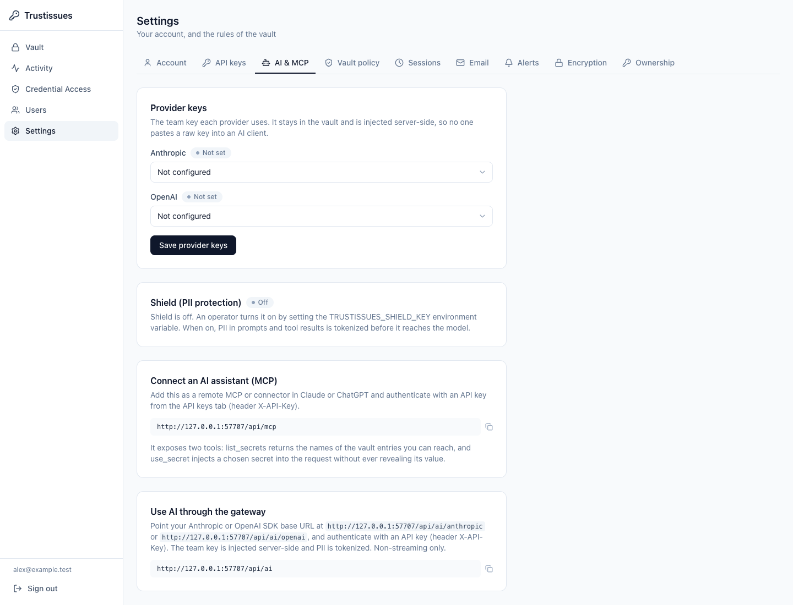
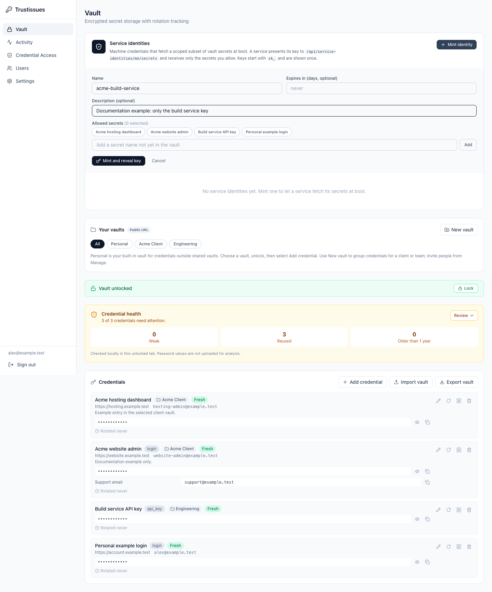

# TrustIssues security and automation guide

This guide explains where TrustIssues protects credentials, who can use them,
and what changes when a browser, an AI assistant or a service needs access.
It describes application release `823c618`, checked on **18 October 2026**.
For creating vaults and using credentials, start with the [user guide](USER-GUIDE.md).
For deployment, team policy and operational procedures, use the [administrator guide](ADMIN-GUIDE.md).

Screenshots show the real application running in an isolated demonstration
instance at that release. They use synthetic records and an administrator
account. They are not pictures of production credentials, and an ordinary
member or client account will see fewer controls. A screenshot of a setting is
an illustration of the feature, not proof that it is enabled on your instance.

## 1. The trust model: what encryption means here

TrustIssues encrypts secret values and supported entry metadata on the server
before storing them in SQLite. The encryption is AES-256-GCM. Keys are derived
from the operator's `TRUSTISSUES_VAULT_KEY` using PBKDF2-SHA256 with 600,000
iterations. Account passwords are stored as password hashes, not as the keys
that encrypt each person's vault. Current password hashing uses Argon2id;
legacy bcrypt hashes are upgraded when their owner signs in.

**TrustIssues uses server-side encryption. It is not end-to-end encrypted or
zero knowledge.** The running server must decrypt credentials to release them
to an authorized user, rotate them, or inject them into an integration. The
operator and anyone who controls the host or its vault key can decrypt them.
An authorized browser receives plaintext after unlocking; a compromised browser
or extension can read what that browser can read.

The database is still sensitive without its vault key. Account identifiers,
password hashes, collection names, membership and access policies are examples
of operational data that are not hidden by entry encryption. Older audit
history can also contain readable metadata. Encrypt complete database backups
before off-host storage and keep matching vault keys separately.

See the [security policy](../SECURITY.md) and [threat model](../THREAT-MODEL.md)
for implementation details and additional limits.

## 2. The different passwords, keys and tokens

| Credential | What it does | What it does not do |
| --- | --- | --- |
| TrustIssues account password | Signs you in and authorizes password-gated actions such as Unlock and export | It is not the instance encryption key or a PGP export password |
| TOTP code or single-use recovery code | Completes two-factor sign-in when enabled | It does not recover a lost server vault key |
| Server vault key | Encrypts the instance's stored credential data | It is not a user login; do not give it to a browser, assistant or client |
| Personal API key, beginning `ti_` | Authenticates supported API, extension and MCP requests as its owner | A descriptive key name does not create a narrower permission scope |
| Service identity key, beginning `sk_` | Fetches explicitly named secrets for a trusted service under its owner's scope | It does not keep the fetched values hidden from that service |
| Capability token | Authorizes one permitted proxy use of a stored credential for a short time | It is not the underlying credential and cannot authorize arbitrary destinations |
| PGP passphrase or private key | Decrypts a portable encrypted export | TrustIssues cannot reset it to recover the export |

Treat API keys, service keys and unspent capability tokens as credentials too.
The fact that a capability does not reveal the stored password does not make
it safe to publish: someone who obtains it may attempt its permitted action.

## 3. Sign-in, Unlock, Lock and sign-out

Sign-in establishes your authenticated session. Collection membership and roles
then determine which records you can access. Being signed in does not mean the
Vault screen has released all its secret values to your browser.

On **Vault**, enter your **TrustIssues account password** and choose **Unlock**.
This is password reauthentication, followed by authorized decryption on the
server. The response contains the accessible values allowed on that ingress.
The sidebar's selected vault is a display filter, not a new encryption key or
an independent security identity.

Choose **Lock** when you finish. Lock clears reachable decrypted entry state,
revealed values, relevant forms and mutation-cache data, and closes import and
export dialogs. Leaving the Vault page also invokes this cleanup. It does not
securely erase immutable JavaScript strings from browser memory or erase values
already copied, exported or used by another program.

The vault's automatic lock is a maximum unlocked window, defaulting to
15 minutes unless an administrator changes the policy. It is measured from
unlocking; continuing to interact does not turn it into an inactivity timer.
The HTTP session's idle expiry is separate. **Sign out** ends the authenticated
session; **Lock** keeps you signed in while sealing the Vault interface.

Copied values have a best-effort 20-second clipboard clear. The browser must
permit clipboard reading and writing, and the value must still match the one
copied. Clipboard managers and applications that already received it can retain
copies. Do not rely on that timer as guaranteed erasure.

## 4. Let an AI use a credential without receiving its value

The shipped AI boundary is a remote MCP endpoint plus a capability proxy.
It lets an assistant ask for a limited use of a credential while TrustIssues
performs the sensitive part on the server. This release does not ship an
installed local IDE broker that automatically wraps arbitrary terminal commands.
An IDE must support the remote connection and use this proxy workflow.

```mermaid
sequenceDiagram
    participant A as IDE or AI assistant
    participant T as TrustIssues
    participant P as Approved API
    A->>T: list_secrets using authenticated MCP
    T-->>A: Accessible entry names, no values
    A->>T: use_secret with name and destination
    T-->>A: Short-lived capability and proxy URL
    A->>T: HTTP request with capability
    T->>T: Recheck access and destination; consume token
    T->>P: Request with real credential injected
    P-->>T: API response
    T-->>A: Response subject to credential-reflection guards
```

The approved API receives the real credential because it needs to authenticate
the request. The assistant receives the capability, the destination and the
result. TrustIssues still sees plaintext while injecting it. This boundary
reduces disclosure to the assistant; it does not remove trust in the server,
the upstream API or the operation that the assistant asks that API to perform.

### Prepare an entry for agent use

1. Create or open the credential in **Vault**, then unlock and edit it.
2. Configure its supported provider and required provider details where applicable.
3. In **Agent access**, enter an approved host and a narrow path pattern, one per line.
4. Save, then test a harmless request against the intended API before permitting consequential work.

For example, an illustrative destination pattern is:

```text
api.example.com/v1/projects/*
```

Replace that example with the actual service's host and routes. Host wildcards
such as `*.example.com` are rejected. Empty **Agent access** blocks capability
issuance. Only the entry's creator or an instance administrator can expand the
destination list; an accepted editor can narrow or clear it.

The destination list is a ceiling, not a recipe for authenticating any API.
The provider's injection configuration must also know how to place the secret,
for example into an authorization header. Adding a host to a generic credential
does not automatically create a new provider adapter or arbitrary authentication
format. Use a supported provider/configuration and verify it before relying on it.

### Connect the assistant

1. Sign in interactively and open **Settings → API keys**.
2. Give the integration a recognizable name and choose **Create key**.
3. Copy the key once into the connector's protected authentication configuration.
4. Open **Settings → AI & MCP** and copy the endpoint shown under **Connect an AI assistant (MCP)**.
5. Configure the client to authenticate with the `X-API-Key` header.
6. Ask it to list available entries, then request a narrowly specified use.

The remote endpoint uses JSON-RPC over HTTP. Client support differs; copying
its URL does not automatically connect every IDE. Keep API keys out of source,
prompts and transcripts. A key acts as its user within the application's role
and access checks; it is not limited merely by the name you gave it.



*The connection card supplies the instance's endpoint. Provider configuration
and Shield status are separate from connecting an assistant.*

### What the MCP tools actually return

| Tool | Input | Result |
| --- | --- | --- |
| `list_secrets` | No arguments | Accessible entry names; never stored values |
| `use_secret` | `name` and optional `destination` within the entry's ceiling | Token, proxy URL, secret name and expiry |

The assistant sends its HTTP request to the returned proxy using
`Authorization: Capability <token>`. The default lifetime is five minutes,
capped at ten minutes. A capability is single use; do not replay it after a
timeout or assume an uncertain upstream operation did not happen.

Issuance and use enforce current entry access, collection policy and destination
constraints. A requested destination can narrow the entry's ceiling, never
expand it. The proxy does not follow redirects with the credential. A revoked
membership or narrowed ceiling is checked again when a token is spent; it is
not enough to have obtained the token earlier.

There is no agent-grant management screen in this release. When an agent has
no explicit grant rows, current entry access supplies the implicit grant.
Do not assume separate per-agent approvals exist because the schema contains
a grant table. Account role, current membership, destination ceilings and the
client's permitted actions remain essential controls. `vault_only` accounts
cannot mint capabilities or use MCP or the AI gateway.

### Information the AI can still see

MCP entry names, inventory, destinations, capability tokens and proxy URLs are
returned verbatim so the client can use them. Do not put passwords, customer
personal details or other sensitive content into entry names. These MCP results
are not blanket-filtered by Shield.

The proxy checks upstream response headers and bodies for reflection of the
injected credential in supported common encodings. A detected reflection is
withheld or the connection is aborted. This is a guard against ordinary echo
responses, not a guarantee against a malicious upstream cooperating with a
caller through an unknown encoding or covert channel. Choose destinations you
trust and review the action as well as the credential's disclosure risk.

## 5. The AI gateway: share provider access without sharing the provider key

The gateway is a separate use case: an application calls an AI provider through
TrustIssues instead of holding the team's upstream API key.

1. An administrator stores the provider key as a Vault entry in category **API Key** (`api_key`).
2. In **Settings → AI & MCP**, select the Anthropic or OpenAI entry and choose **Save provider keys**.
3. Configure the application with the gateway base URL displayed there and its own TrustIssues API key in `X-API-Key`.
4. Use non-streaming inference requests. Streaming is not supported by this gateway release.

The provider key is injected server-side and pinned to its selected provider's
API host. Provider administration, deletion and other unrestricted API routes
are refused. Supported inference routes include OpenAI chat, responses,
embeddings, moderation and completions, and Anthropic messages, token counting
and completions, plus the allowed model-list/read routes. See the
[README's exact route table](../README.md#ai-gateway-and-mcp-use-ai-while-keeping-secrets).

**Shield (PII protection)** is optional and operator configured. When enabled,
the gateway tokenizes recognized structured data, such as email addresses,
phone numbers, Swedish personal identity numbers and IBANs, before forwarding
the prompt. Arbitrary names, companies and every possible secret in free text
are not automatically recognized. Hint settings can also reveal limited
derived information. When Shield is off, prompt content passes through unchanged.

The external AI provider still receives the resulting prompt and processes it.
Shield does not make the conversation invisible to that provider, and it does
not turn the gateway into a general way to upload sensitive files safely.

## 6. Service identities: intentionally release secrets to trusted machines

Service identities support applications that need real credentials at boot.
An administrator opens **Vault → Service identities → Mint identity**, supplies
a name, selects **Allowed secrets**, optionally sets **Expires in (days)**,
then mints and stores the one-time `sk_` key securely.



*Allowed names define the fetch list. The service key and the returned values
are credentials; the screenshot uses demonstration records only.*

The service calls `POST /api/service-identities/me/secrets` with an
`X-Service-Key` header. It receives **plaintext values** for the permitted
names. Fetches resolve the minting owner's personal entries, not arbitrary
shared collections or another user's credentials. A selected shared entry in
the interface does not override that server-side restriction.

The identity must be live, unexpired and unrevoked, and its owning account must
remain active. Required TOTP enrollment also applies through the owner. A
missing or inaccessible allowed name can refuse the fetch instead of silently
providing an incomplete configuration. Store fetched values only where the
service needs them, such as a tightly permissioned RAM-backed runtime file.

Use the identity's audit view to inspect fetches, and revoke a key when the
service no longer needs access. Revocation prevents future fetches; it cannot
erase a value that the service already obtained. Rotate the upstream credential
when a previously fetched copy must stop working. Do not give this key to an
AI assistant when your goal is to keep plaintext credentials away from it.

## 7. Private access policies add an inbound network gate

Optional private ingress connects a distinct private HTTPS hostname to an
application-owned Unix socket, commonly through Tailscale or Headscale.
It must be configured by the operator; a vault's name or a network-looking
request header cannot create private access.

| Choice in vault management | Through the public URL | Through configured private ingress |
| --- | --- | --- |
| **Standard access** | Authorized metadata and secret actions work | Same access checks |
| **Private for secret actions** | Metadata remains visible; protected secret actions are refused | Authorized secret actions work |
| **Private for all access** | Collection and entry metadata are hidden | Authorized operations work |

Private policy adds to sign-in, MFA, roles, membership and audit; administrators
are not exempt. Personal entries remain standard unless moved into a protected
collection. If private connectivity fails, protected work stays blocked rather
than falling back to public. Ask the operator for the exact private URL and
network access. Do not invent a URL or expose the socket to work around policy.

This controls admission to the application. It does not add a second encryption
mode, automatically route outgoing provider traffic through the VPN, or cancel
requests already admitted before a policy change. Scheduled rotations run under
server authority even when the private connector is unavailable. Values already
revealed cannot be recalled by disconnecting the VPN.

Use [private ingress](PRIVATE-INGRESS.md) for connector setup, extension routing
and the tested break-glass procedure. A `/health` response identifies the
listener that handled it; it does not prove that every team device can reach it.

## 8. Encrypted files, recovery and revocation

PGP protects a portable export in storage or transit. Import decrypts in the
browser and sends decrypted content to TrustIssues for validation and storage.
Export obtains authorized JSON from the server and encrypts in the browser
before download. PGP keys/passphrases are not uploaded. Sender signatures are
not verified. Read [PGP import and export](PGP-IMPORT-EXPORT.md) and
[vault portability](PORTABILITY.md) before migrating important data.

A native export is not an instance disaster-recovery backup: memberships,
account credentials, audit history and operational authority do not transfer.
The currently selected sidebar vault does not limit an export to that vault.
Public-route exports omit protected collections; private-route export still
requires the caller's normal access. See the [user guide](USER-GUIDE.md) for the
format selection and confirmation screens.

Keep recovery mechanisms separate. A TOTP recovery code can help with a lost
authenticator; another administrator may help with an account password. Neither
can decrypt a database whose matching server key material has been lost, or
recover a PGP file without its passphrase/private key. A sole administrator's
lockout needs the documented operator procedure, not an improvised login bypass.
See [administrator lockout recovery](ADMIN-LOCKOUT-RECOVERY.md).

An operator rotating the server vault key must retain the previous key, restart
with both keys, run **Settings → Encryption → Re-encrypt everything with the current key**,
verify completion, then remove the previous key from the running configuration.
Retained older snapshots may still require older keys. Follow the complete
[key rotation instructions](../SECURITY.md#rotating-the-vault-key) and
[backup runbook](BACKUP.md); changing a key variable alone is not a completed rotation.

Audit records help attribute activity, but they do not undo it. Removing a
member, revoking an API/service key or clearing Agent access blocks future work
subject to the relevant checks. None of these actions erases an exported file,
a copied password, a service's runtime secret or a completed upstream action.
Use provider-side rotation/revocation when an already disclosed credential must
cease to authenticate, and verify the old credential's actual fate for that provider.
