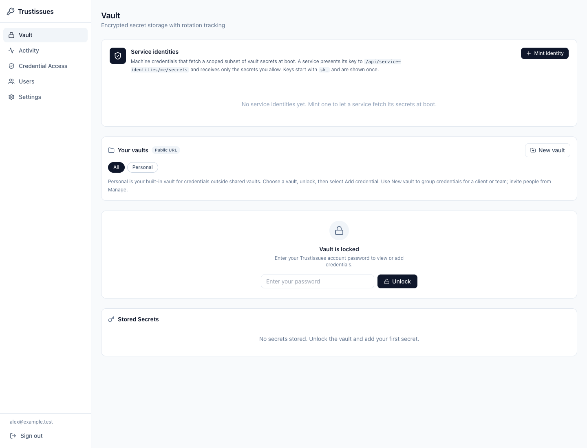
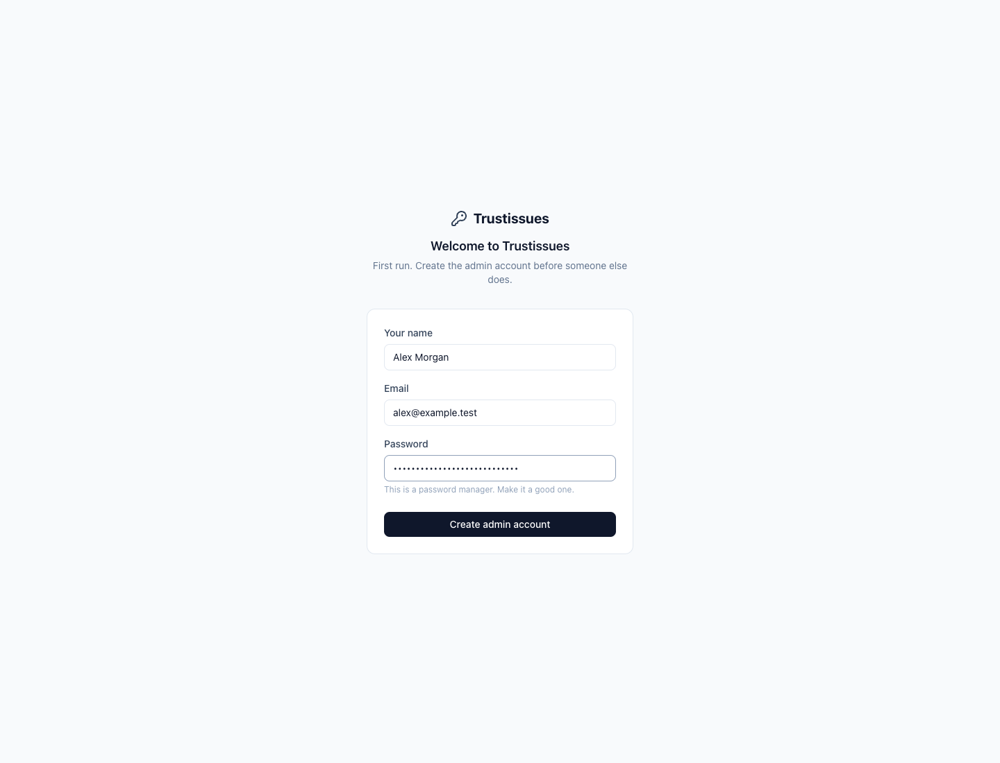
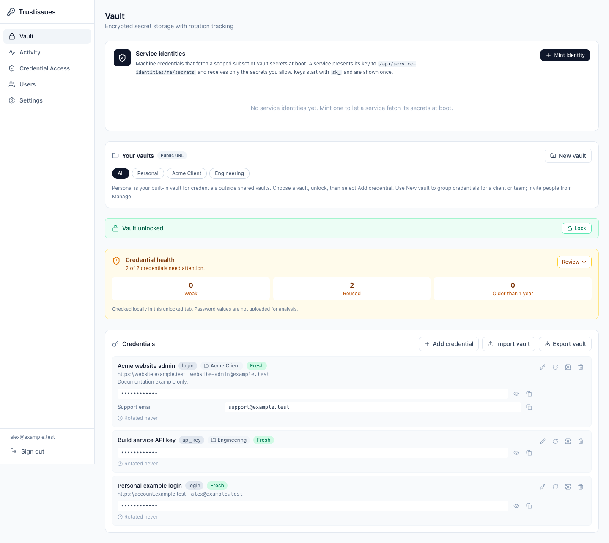
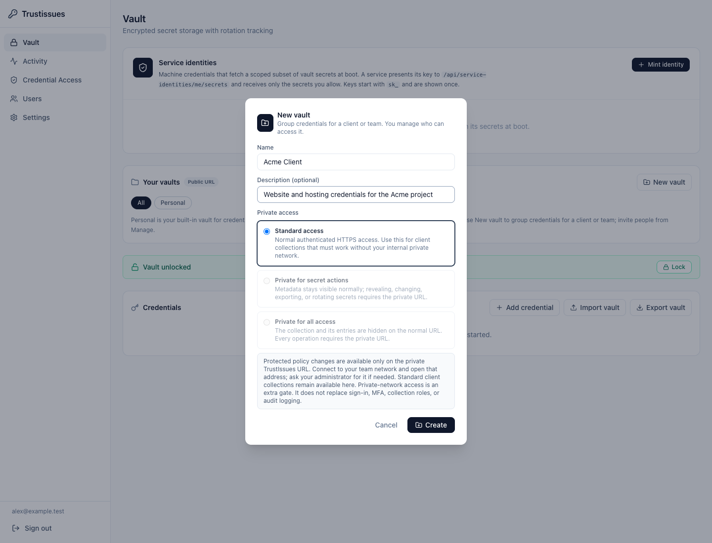
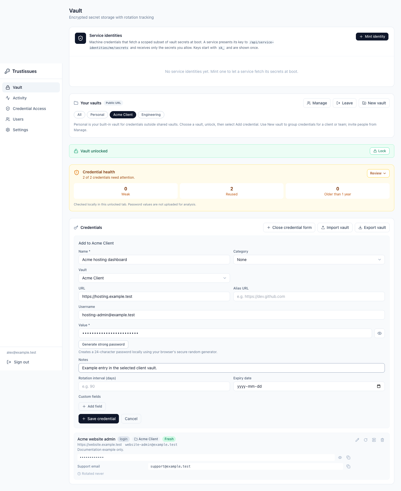
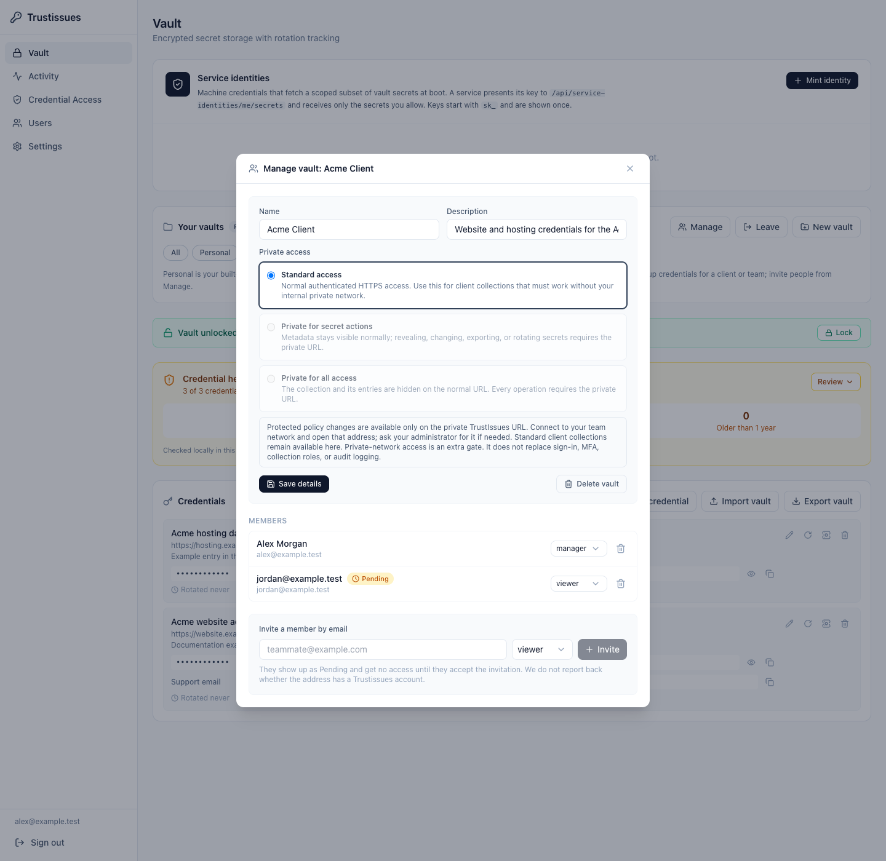
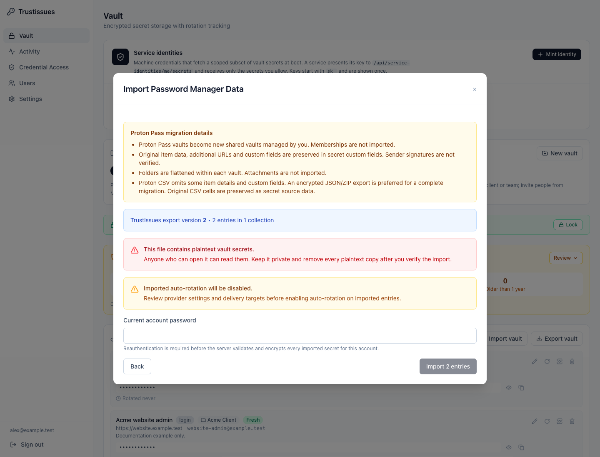
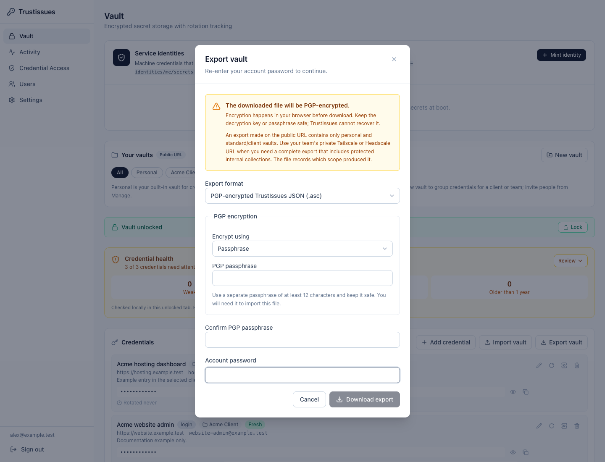

# TrustIssues user guide

TrustIssues stores passwords, API keys and other credentials for one team. You
can keep entries in your built-in **Personal** vault, organize client or team
credentials into named shared vaults, and control who can use each shared vault.
It also provides migration tools, encrypted exports and optional automation.

This guide explains the web app at release **`823c618`**, reviewed on
**18 October 2026**. Screenshots show a real, disposable local instance with
fictional people, `.test` websites and demonstration credentials. They show an
administrator account; your available controls depend on your account and vault
roles. Screenshots contain no real customer credentials. See the
[screenshot notes](screenshots/user-guide/README.md) for their scope.

## Find the right instructions

| What you want to do | Where to start |
|---|---|
| Sign in and add your first password | [Start here](#1-sign-in-and-unlock) |
| Understand Personal and create a client vault | [Choose or create a vault](#2-choose-or-create-a-vault) |
| Add, find, reveal or change a credential | [Work with credentials](#3-add-and-use-credentials) |
| Give a client or teammate access | [Sharing](#4-share-a-vault-with-a-client-or-teammate), then the [administrator guide](ADMIN-GUIDE.md) |
| Move from Proton Pass | [Proton Pass migration](#5-import-from-proton-pass) |
| Save a PGP-encrypted export | [Export](#7-export-your-credentials) |
| Set up MFA, users, rotation or audit review | [Administrator and account guide](ADMIN-GUIDE.md) |
| Understand encryption, AI/IDE access or service identities | [Security and automation guide](SECURITY-AND-AUTOMATION-GUIDE.md) |
| Operate backups and disaster recovery | [Backup and restore runbook](BACKUP.md) |

## The main ideas

**Account:** your identity in the instance: email, password, MFA and account
role. An invitation to create an account does not by itself grant access to a
shared vault.

**Credential / entry:** one stored record, such as a website login or API key.
It has a name and secret value, plus optional username, URLs, notes and custom
fields. Its category describes the data; choosing “API Key” alone does not
configure a provider, rotate anything or authorize an AI assistant.

**Vault / collection:** a grouping of credentials. The UI uses “vault”; some
API names, audit events and older documentation use “collection.” They refer to
the same shared grouping. Personal is the built-in destination for entries
outside shared vaults.

**Locked / unlocked:** signing in establishes your account session. Unlocking
separately authorizes loading accessible secret values into this browser tab.
Locking clears the app's unlocked state; it does not sign you out.

**Important trust boundary:** TrustIssues encrypts stored secrets on its server.
The server can decrypt authorized data, and administrators can access users'
Personal entries. It is not an end-to-end or zero-knowledge vault. An unlocked
browser, the served application and the server operator remain trusted.

## 1. Sign in and unlock

### Join an existing instance

1. Open the HTTPS address supplied by your administrator.
2. If you received an account invitation, open that invitation, choose your
   password, and finish account creation. Otherwise sign in with your existing
   email and password.
3. If MFA is enabled, enter the current authenticator code or a recovery code
   when prompted, then choose **Verify**.
4. If the team requires MFA and you have not enrolled, complete enrollment in
   **Settings → Account**. Account settings remain reachable while credential
   operations are blocked by this requirement.
5. Open **Vault**. Enter your account password in **Vault is locked**, then
   choose **Unlock**.

*The vault can show permitted entry metadata while locked. The unlock form
controls loading secret values. Admin-only Service identities appears above
Your vaults in this example.*

Use **Lock** when finished, especially on a shared computer. Sign out using the
sidebar when you want to end the account session too. By default, the vault
locks 15 minutes after unlocking, even if you remain active; the administrator
can change this maximum window. Login-session expiry is a separate setting.

### Set up a brand-new instance

Only the operator creating a new instance uses first-run setup. The first
account becomes administrator; public registration closes afterward. Other
people join by invitation or an administrator-created account.

*This screen belongs to an uninitialized instance. If your team already has
TrustIssues, use its sign-in or invitation flow instead.*

## 2. Choose or create a vault

### Understand the filters

In **Your vaults**, choose:

| Filter | What it means |
|---|---|
| **All** | Entries visible to your account across the permitted scopes |
| **Personal** | Your built-in destination for credentials outside named shared vaults |
| A named vault, such as **Acme Client** | Credentials in that shared collection, subject to your accepted membership and role |

Personal already exists. You do not need to create it or configure members
before adding your first credential. Its name describes organization, not
secrecy from the instance administrator.

*Your vaults chooses the working view. Credential health is a local review aid;
the masked rows below it are the stored entries. A selected filter is not an
export boundary.*

### Create a client or team vault

1. In **Vault → Your vaults**, choose **New vault**.
2. Enter a clear name, such as `Acme Client`, and an optional description.
3. Choose **Standard access** for a vault that clients must use over ordinary
   authenticated HTTPS. The protected options require a separately configured
   private URL and must be selected from that route.
4. Choose **Create**.
5. Select the new named vault, unlock if necessary, then choose **Add credential**.

*Creating a vault creates an empty grouping and makes you its manager. It does
not add credentials, create accounts or share anything automatically. Greyed
protected choices mean this connection cannot select them.*

### Public and private access

The **Public URL** or **Private URL** badge describes which application listener
you are using. “Public” still requires sign-in and permissions; it does not mean
the vault is open to the internet without authentication.

| Vault policy | Ordinary URL | Configured private URL |
|---|---|---|
| **Standard access** | Authorized metadata and secret operations | Same account and role checks |
| **Private for secret actions** | Metadata can be visible; protected secret operations are blocked | Authorized secret operations work |
| **Private for all access** | Vault and entry metadata are hidden | Authorized access works |

Ask your administrator for the exact private URL and network instructions. A
VPN connection alone does not change an ordinary URL into the private route.
See [private ingress](SECURITY-AND-AUTOMATION-GUIDE.md#7-private-access-policies-add-an-inbound-network-gate)
for the security boundary and failure behavior.

## 3. Add and use credentials

### Add a credential to Personal or a named vault

1. Select **Personal** or a named vault you can edit.
2. Unlock the vault with your account password.
3. Choose **Add credential**.
4. Check the **Add to …** heading and **Vault** selector. They are the destination
   for the new entry. You can change that selector before saving.
5. Enter **Name** and **Value**, then any useful optional fields.
6. Choose **Save credential**. A successful write may lock the vault again;
   unlock to continue viewing its contents.

*The Vault field determines where the credential is stored. The example's
secret is masked. Naming the entry clearly makes it easier to find without
putting the secret itself into the name.*

| Field | What to enter and what it changes |
|---|---|
| **Name** | A recognizable label, such as “Acme hosting dashboard.” Avoid passwords or sensitive details in names; names can appear in metadata and connected tools. |
| **Category** | Login, Password, API Key, Database, Certificate or Other. This organizes the record and may offer suitable custom fields. |
| **Vault** | Personal or a shared vault where you have write permission. |
| **URL** | The primary website/service address. It helps identify the login and can be used by the extension's matching workflow. |
| **Alias URL** | An additional associated address. It is not an AI destination grant. |
| **Username** | The login name or email for the service. |
| **Value** | The actual password, token, certificate text or other secret. |
| **Notes** | Context for humans, such as which environment uses the credential. |
| **Rotation interval** | Rotation timing metadata; setting this alone does not enable an upstream provider or automated delivery. |
| **Expiry date** | When the credential expires or should be reviewed. It does not renew the upstream account. |
| **Custom fields** | Additional labeled values. Mark sensitive values secret so the UI hides them until revealed. |

**Generate strong password** creates a 24-character value locally using your
browser's secure random generator. If the input already has a value, choose
**Replace with generated password** to confirm replacement or **Keep current
value** to cancel. Generation fills the form; you still need to save it. It does
not change the password at a website or update an existing service by itself.

If **Add credential** is disabled for a selected vault, check your role. A
viewer can use its existing credentials but cannot create or edit entries.
Choose Personal or ask a manager for editor access.

### Find, reveal and copy

Use the vault filters to reduce the visible list. Entry rows show their name,
category and available contextual information. Unlock before revealing a value.
Use the eye control to **Reveal** or hide a secret and the copy control for the
value you need. Custom secret fields have their own reveal controls.

Copying places plaintext on your system clipboard. The app attempts to clear
its copied value after 20 seconds if the browser allows it and the clipboard
still contains that value. This is best effort: other applications, clipboard
history and screenshots may keep copies.

### Edit, move or delete

Choose the row's **Edit entry** control to change its details. In the edit form,
an empty replacement-value field keeps the current secret; enter a new value
when you intend to change it. Save the edit and check the resulting entry.

Moving an entry changes who can reach it. Open **Edit entry** and use
**Collection (moves the entry when changed)** to choose a permitted destination.
**The move is sent immediately when you change this selector; it does not wait
for Save, and Cancel does not undo it.** Review both source and destination
permissions before changing it. Moving or copying a credential is not the same
as rotating its upstream password; anyone who already learned that value may
still use it elsewhere.

**Delete secret** permanently removes the stored entry after confirmation. It
does not delete an upstream account, revoke an API key at its provider or erase
copies that someone already made. There is no ordinary UI undo. For a real
service, decide whether the upstream credential must also be revoked or rotated.

### Interpret credential health

The health summary checks login/password-like entries for weak patterns,
exactly reused values and values older than one year. Age uses the last value
rotation, or creation time when no rotation is recorded; editing notes does not
reset it. Use **Review** to inspect the reasons. The analysis runs over values
already in this unlocked tab and does not upload them to a password-analysis
service. It does not prove a credential works upstream or has never appeared
in a breach. API-key-only entries may not qualify for these password checks.

## 4. Share a vault with a client or teammate

Select the named vault and choose **Manage**. Under **Invite a member by email**,
enter the person's email, choose viewer/editor/manager, and choose **Invite**.
The person must accept the pending vault invitation before receiving access.

*Jordan is Pending in this example and does not yet have vault access. The
viewer role will allow revealing and using credentials once accepted.*

Use **viewer** for someone who should use existing credentials, **editor** for
someone who should also change them, and **manager** for someone who should
manage the vault and its membership. Giving someone vault management rights
does not automatically make them an instance administrator.

For a new external client, you need two invitations: an account invitation
from **Users**, usually with the **Vault only** account role, and a membership
invitation for the specific client vault. Use the same email. The
[client onboarding checklist](ADMIN-GUIDE.md#set-up-an-external-client) explains
the full order, MFA and browser-extension connection.

### Leave or delete a vault

**Leave** gives up your own membership. It does not delete the vault for other
members. The last accepted manager must arrange another manager before leaving.

**Manage → Delete vault** deletes the vault's credentials and memberships. The
app checks and displays the credential count before allowing confirmation.
Read that count carefully. If it changes before deletion, review the new count
and confirm again. If the check fails, use **Retry**; a failed check is not an
empty vault. Backups are an operator recovery mechanism, not a per-vault undo.

## 5. Import from Proton Pass

### Choose an export format

Prefer Proton's encrypted JSON/ZIP export for a fuller migration. Proton CSV is
supported, but TrustIssues cannot recover details Proton omitted from the CSV.
Disable attachments when preparing an encrypted Proton export; archives with
attachments are refused rather than silently dropping files.

You can select a Proton encrypted ZIP, its extracted `Proton Pass/data.pgp`,
decrypted Proton JSON or Proton CSV. Consult the current
[Proton export instructions](https://proton.me/support/pass-export) if its own
settings menu differs from the version you use.

### Preview and confirm

1. Unlock **Vault** and choose **Import vault**.
2. Select your file. Auto-detection recognizes Proton CSV; choose **Proton Pass
   CSV** explicitly if you want to specify it.
3. For an encrypted export, choose passphrase decryption and enter the
   passphrase you chose when exporting it. This is not your TrustIssues account
   password. A recipient-encrypted file instead needs the matching private key.
4. Choose **Preview Import**.
5. Read the entry/vault counts, **Proton Pass migration details**, warnings and
   any conflict messages. The preview should show names and counts, not secret
   password values.
6. Enter **Current account password** and choose **Import N entries**.
7. After success, select an imported vault, unlock again if prompted, and check
   representative logins and notes before disposing of the original export.

*Preview is the review step. It does not mean the records have already been
saved. Read the migration warnings before authorizing the import.*

### Where your Proton data goes

Proton imports create new shared vaults managed by you. They do not put every
record into the filter you happened to select before opening Import. Original
Proton memberships are not copied, so invite people explicitly afterward.

| Source content | Result in TrustIssues |
|---|---|
| Nonempty Proton vault | New Standard access shared vault; you are its manager |
| Login password | Main credential value, preserving exact CSV password whitespace |
| Username / email | Username, with email used when username is absent |
| First URL | Main URL |
| Secure note | Credential value |
| TOTP URI | Secret custom field; not automatically a working code generator |
| Other URLs, custom fields and original item data | Preserved in secret source fields, within import limits |
| Passkey data | Retained as source data where supported; cannot sign in as a passkey |
| Folders | Flattened within each vault |
| Duplicate labels | Qualified using a vault name or number |
| Trashed items and empty vaults | Excluded; review the preview counts |
| Attachments | Not imported; prepare an export without them |

Rotation providers, delivery targets and AI destination permissions are not
enabled by migration. Register passkeys separately with the relevant websites.
Check TOTP entries in particular before retiring the original authenticator.

Reimporting is not synchronization. It can create another set of shared vaults.
Before retrying after an uncertain network response, check whether the first
operation already succeeded.

## 6. Import other supported files

**Import vault** also accepts native TrustIssues JSON and supported CSV exports
from Bitwarden, 1Password and LastPass. The format selector helps identify CSV
layouts; changing the file extension does not convert one schema into another.

The older CSV flow imports into your Personal vault and has an editable preview
with validation and skip decisions. It differs from the native/Proton
confirmation screen shown above. Review its row errors; do not assume every
provider's CSV preserves the same fields or grouping. You can deliberately move
an imported Personal entry to a shared vault afterward.

Native TrustIssues imports reconstruct supported content with new record IDs.
Shared vaults are fresh copies managed by the importer, with no copied member
access. Personal-entry name conflicts must be resolved before confirmation.
Names may repeat in different vaults, but duplicates within the same scope are
rejected. Native v2 can retain protected access policies and therefore may need
the private route. See [portability](PORTABILITY.md) for the exact preserved
fields and excluded authority.

### OpenPGP inputs

Armored `.asc` and binary `.pgp` / `.gpg` messages can wrap supported CSV,
TrustIssues JSON or Proton JSON. Use the export's passphrase or matching armored
private key; provide the private-key passphrase if that key is protected.
Renaming an arbitrary encrypted file to `.pgp` is not enough.

The browser decrypts these files in a temporary worker. Your PGP private key
and PGP passphrase are not uploaded, but the decrypted records are sent to
TrustIssues for preview and import. Message integrity is required; this flow
does not verify a sender's PGP signature. See the detailed
[PGP guide](PGP-IMPORT-EXPORT.md).

### Import limits and failures

| Limit | Current behavior |
|---|---|
| Entries / CSV rows | Up to 5,000 |
| Native or decrypted payload | Up to 10 MiB |
| Encrypted input / ZIP payload | Up to 16 MiB |
| Armored key | Up to 256 KiB |
| PGP operation | 60-second worker deadline |

Malformed, oversized or conflicting native migrations are refused rather than
silently truncated. ZIP handling also limits archive records, paths and actual
decompressed output. Closing the dialog cancels local processing, but after
you confirm, it cannot guarantee undo of an import the server already committed.

## 7. Export your credentials

### Check the scope first

**Export vault includes your Personal entries and accepted shared-vault
memberships available on the current route. The selected vault filter does not
limit it.** Accepted viewer access can include exporting that shared vault.
Administrator status does not make this an all-instance export of other users'
Personal entries or unjoined vaults. There is no per-entry “may view but never
export” control.

The ordinary public route omits protected internal collections from an export;
use the configured private route when those entries are required. Review the
scope before giving an exported file to anyone else.

### Download a PGP-encrypted export

1. Unlock **Vault**, then choose **Export vault**.
2. Change **Export format** from **TrustIssues JSON (plaintext)** to
   **PGP-encrypted TrustIssues JSON (.asc)**.
3. Choose passphrase encryption and enter a separate passphrase of at least
   12 characters twice. Store it separately from the exported file. Or choose
   recipient public-key encryption and supply the recipient's armored public
   key; verify its fingerprint through your trusted PGP workflow.
4. Enter your **Account password** to authorize the export.
5. Choose **Download export** and retain the resulting `.json.asc` file.

*The PGP passphrase protects the portable file. Account password authorizes
reading the export from this TrustIssues instance. They have different jobs.*

The server prepares authorized JSON, and the browser encrypts it before
download. An encryption failure does not fall back to a plaintext download.
You need the corresponding private key or PGP passphrase to open the file;
TrustIssues cannot recover a lost one.

The encrypted payload is **TrustIssues native JSON**. PGP is its wrapper, not
Proton's native JSON schema. Do not assume Proton Pass can import it as a Proton
export. Import it into TrustIssues or decrypt it with a compatible OpenPGP tool
and use an explicitly supported conversion workflow.

### Plaintext JSON and backups

Plaintext JSON is an explicit export choice and contains actual credentials,
including secret custom fields. Treat the entire file as sensitive. Check
whether your Downloads folder is synced or backed up before using it.

A vault export is for portability, not full instance recovery. It does not
recreate users, memberships, API/service keys, audit history or active automation
authority. The operator needs a database snapshot and separately protected
matching vault key material for disaster recovery. See [Backup](BACKUP.md).

## 8. Troubleshoot common situations

| What you see | What to check or do |
|---|---|
| Sign-in rejects email or password | Use the exact password most recently saved in TrustIssues Settings. Update the matching password-manager entry for the URL you use. A vault credential and a PGP export passphrase are separate from your account password. |
| Sign-in rejects a two-factor code | Enter a fresh authenticator code or one complete unused 16-character recovery code. A rejected MFA code does not mean the password was incorrect. |
| Sign-in says too many attempts | Stop retrying and follow the displayed waiting period. Failed password and MFA attempts share the sign-in lockout; changing your password does not bypass this protection. |
| “Personal already exists, but how do I add a password?” | Select Personal, unlock, then Add credential. You do not need New vault. |
| A new vault is empty | Creation only made a grouping. Select it and save a credential into its Vault field. |
| Add credential is disabled | Check for viewer access, a locked vault or a collection-loading error. |
| A client cannot see an invited vault | Confirm the account exists with the same email and the client accepted the separate vault invitation. Pending is not accepted. |
| “This action requires the private TrustIssues URL” | Connect to the required private network and use the exact private address from your administrator. |
| Protected choices are greyed out | You are on the ordinary route. A configured private route is needed to select protected policies. |
| “Checking … contents” does not finish or reports an error | Retry the contents check. Never assume the vault is empty; deletion needs a fresh confirmed count. |
| Proton import fails before preview | Check format, passphrase/key, attachments, size and malformed CSV rows. Keep the original export. |
| You are unsure whether an import committed | Inspect the vault list and entries before retrying; reimport can duplicate shared vaults. |
| Export includes more vaults than expected | Export scope follows account access, not the selected filter. |
| A changed account password does not open an old PGP export | Use that file's original PGP passphrase/private key; it is independent of the account password. |
| A stored API key no longer works upstream | Check provider status and rotation results. A vault record is not proof of upstream validity. |
| You lost an MFA device | Use a saved recovery code. Ask an administrator to follow the recovery runbook if those are unavailable. |

When reporting a problem, share the action, file format, approximate item count,
error wording, whether it happened before or after the MFA prompt, and relevant release version. Do not include secret values,
private keys, account passwords, recovery codes or full credential exports in a
support message or screenshot.

## Continue reading

- [Account, client onboarding and administrator guide](ADMIN-GUIDE.md)
- [Security and automation guide](SECURITY-AND-AUTOMATION-GUIDE.md)
- [PGP import and export reference](PGP-IMPORT-EXPORT.md)
- [Native portability contract](PORTABILITY.md)
- [Security policy](../SECURITY.md) and [threat model](../THREAT-MODEL.md)
- [Private ingress operations](PRIVATE-INGRESS.md)
- [Backup and restore](BACKUP.md) and [administrator lockout recovery](ADMIN-LOCKOUT-RECOVERY.md)
